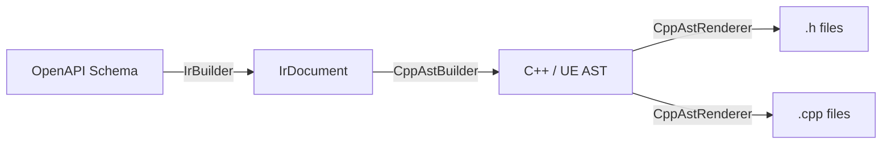

# Unreal Engine C++ HTTP Client Generator

## Architecture Overview

The generator follows the same `IR -> AST -> Code` pipeline used by TypeScript and CSharp generators:




The generator produces the following file structure per API client (tag):

```
Output/
  Models/
    F{ModelName}.h              -- USTRUCT DTO per schema model
  Enums/
    E{EnumName}.h               -- UENUM per schema enum
  Params/
    F{OperationName}Params.h    -- Params container (Route/Query/Body/Form sub-structs)
  Results/
    F{OperationName}Result.h    -- Typed result (StatusCode + SuccessBody + ErrorBody)
  {ClientName}Api.h             -- Delegates, async actions, native fn declarations, PathsLibrary
  {ClientName}Api.cpp           -- Parse fns, native fn impls, async action impls, paths impls
```

---

## Phase 1: C++/UE-Specific AST Nodes

All new nodes live in `ValIO.Generators.Cpp/Ast/Nodes/`. Each node extends core `AstNode` or `DeclarationNode` from [ValIO.Core/Ast/Nodes](ValIO.Core/Ast/Nodes). Each implements `Accept<TResult>` dispatching to `ICppAstVisitor<TResult>`.

### 1.1 File-level Nodes

`**CppHeaderFileNode**` : `AstNode`

- Represents a complete `.h` file
- Properties: `PragmaOnce` (bool), `Includes` (list of `CppIncludeDirectiveNode`), `ForwardDeclarations` (list of `CppForwardDeclarationNode`), `Declarations` (list of `AstNode` -- structs, classes, functions, delegates, usings)
- Comment block at top (copyright, generated notice)

`**CppSourceFileNode**` : `AstNode`

- Represents a complete `.cpp` file
- Properties: `Includes` (list of `CppIncludeDirectiveNode`), `AnonymousNamespaceMembers` (list of `AstNode`), `Implementations` (list of `AstNode`)

`**CppIncludeDirectiveNode**` : `AstNode`

- Properties: `Path` (string), `IsSystemInclude` (bool -- angle brackets vs quotes)

`**CppForwardDeclarationNode**` : `AstNode`

- Properties: `TypeKeyword` (class/struct/enum), `Name` (IdentifierNode)

`**CppUsingAliasNode**` : `AstNode`

- Properties: `Alias` (IdentifierNode), `TargetType` (TypeNode)
- Renders: `using FValIOClientRef = TSharedRef<FValIOClient>;`

### 1.2 UE Declaration Nodes

`**UStructDeclarationNode**` : `TypeDeclarationNode`

- Represents `USTRUCT(BlueprintType) struct F{Name} { GENERATED_BODY() ... };`
- Properties: `Specifiers` (UStructSpecifiers record), `Fields` (list of `UPropertyFieldNode`), `Methods` (list of methods like `IsSuccess()`)
- UStructSpecifiers: `BlueprintType` (bool), `Meta` (dictionary of meta key-values)

`**UPropertyFieldNode**` : `DeclarationNode`

- Represents `UPROPERTY(...) Type Name = Default;`
- Properties: `Type` (TypeNode), `DefaultValue` (ExpressionNode?), `Specifiers` (UPropertySpecifiers record)
- UPropertySpecifiers: `EditAnywhere` (bool), `BlueprintReadWrite` (bool), `BlueprintReadOnly` (bool), `BlueprintAssignable` (bool), `Category` (string?), `DisplayName` (string?), `Meta` (dictionary)

`**UClassDeclarationNode**` : `TypeDeclarationNode`

- Represents `UCLASS(...) class MODULE_API U{Name} : public U{Base} { GENERATED_BODY() ... };`
- Properties: `Specifiers` (UClassSpecifiers record), `ApiMacro` (string -- e.g. "WIREFRAME_API"), `PublicMembers` / `ProtectedMembers` (lists of DeclarationNode)
- UClassSpecifiers: `Meta` (dictionary -- e.g. `ExposedAsyncProxy = "AsyncTask"`)

`**UFunctionDeclarationNode**` : `DeclarationNode`

- Represents `UFUNCTION(...) static RetType FuncName(...);`
- Properties: `ReturnType` (TypeNode?), `Parameters` (list of CppParameterNode), `Specifiers` (UFunctionSpecifiers record), `IsStatic` (bool), `IsVirtual` (bool), `IsOverride` (bool), `IsConst` (bool)
- UFunctionSpecifiers: `BlueprintCallable` (bool), `BlueprintPure` (bool), `Category` (string?), `Meta` (dictionary)

`**UDelegateDeclarationNode**` : `AstNode`

- Represents `DECLARE_DYNAMIC_MULTICAST_DELEGATE_OneParam(FDelegateName, ParamType, ParamName);`
- Properties: `DelegateName` (IdentifierNode), `Parameters` (list of `(TypeNode, IdentifierNode)` tuples)
- The macro variant is derived from parameter count (Zero/One/Two/...)

`**UEnumDeclarationNode**` : `DeclarationNode`

- Represents `UENUM(BlueprintType) enum class E{Name} : uint8 { ... };`
- Properties: `UnderlyingType` (TypeNode), `Values` (list of `UEnumValueNode`)

### 1.3 C++ Function/Method Nodes

`**CppFreeFunctionNode**` : `DeclarationNode`

- Free function (not a class member)
- Properties: `ReturnType` (TypeNode), `Parameters` (list of CppParameterNode), `Body` (BlockNode?), `IsDeclarationOnly` (bool -- for .h forward declaration)
- Used for native TFuture API methods and Parse functions

`**CppParameterNode**` : `DeclarationNode`

- Properties: `Type` (TypeNode), `IsConst` (bool), `IsReference` (bool), `IsPointer` (bool), `DefaultValue` (ExpressionNode?)

`**CppMethodImplementationNode**` : `AstNode`

- Represents `RetType ClassName::MethodName(...) { ... }`
- Properties: `ClassName` (IdentifierNode), `MethodName` (IdentifierNode), `ReturnType` (TypeNode?), `Parameters` (list), `Body` (BlockNode), `IsVirtual` (bool)

### 1.4 AstNodeKind Extensions

Add to the existing `AstNodeKind` enum in [ValIO.Core/Ast/Enums/AstNodeKind.cs](ValIO.Core/Ast/Enums/AstNodeKind.cs):

- `CppHeaderFile`, `CppSourceFile`, `CppIncludeDirective`, `CppForwardDeclaration`, `CppUsingAlias`
- `UStruct`, `UPropertyField`, `UClass`, `UFunction`, `UDelegate`, `UEnum`
- `CppFreeFunction`, `CppParameter`, `CppMethodImplementation`

---

## Phase 2: Visitor Interface and Base

### 2.1 `ICppAstVisitor<TResult>` : `IAstVisitor<TResult>`

Located in `ValIO.Generators.Cpp/Ast/Visitors/ICppAstVisitor.cs`:

```csharp
public interface ICppAstVisitor<TResult> : IAstVisitor<TResult>, IHttpAstVisitor<TResult>
{
    TResult VisitCppHeaderFile(CppHeaderFileNode node);
    TResult VisitCppSourceFile(CppSourceFileNode node);
    TResult VisitCppIncludeDirective(CppIncludeDirectiveNode node);
    TResult VisitCppForwardDeclaration(CppForwardDeclarationNode node);
    TResult VisitCppUsingAlias(CppUsingAliasNode node);
    TResult VisitUStruct(UStructDeclarationNode node);
    TResult VisitUPropertyField(UPropertyFieldNode node);
    TResult VisitUClass(UClassDeclarationNode node);
    TResult VisitUFunction(UFunctionDeclarationNode node);
    TResult VisitUDelegate(UDelegateDeclarationNode node);
    TResult VisitUEnum(UEnumDeclarationNode node);
    TResult VisitCppFreeFunction(CppFreeFunctionNode node);
    TResult VisitCppParameter(CppParameterNode node);
    TResult VisitCppMethodImplementation(CppMethodImplementationNode node);
}
```

### 2.2 `CppAstVisitorBase<TResult>` : `BaseAstVisitor<TResult>`, `ICppAstVisitor<TResult>`

Abstract base class with default dispatch in `Visit(AstNode)` and abstract methods for all C++ nodes.

---

## Phase 3: UE Type Mapper

### 3.1 `UETypeMapper` (in `Services/UETypeMapper.cs`)

Maps `IrType` to UE C++ `TypeNode`. Key mappings:


| IrPrimitiveKind | UE C++ Type          | Default Value |
| --------------- | -------------------- | ------------- |
| String          | `FString`            | `""` (empty)  |
| Number          | `double`             | `0.0`         |
| Integer         | `int32` / `int64`    | `0`           |
| Boolean         | `bool`               | `false`       |
| DateTime        | `FDateTime`          | --            |
| Date            | `FDateTime`          | --            |
| Uuid            | `FGuid`              | --            |
| Binary / File   | `TArray<uint8>`      | --            |
| Any             | `FString` (fallback) | --            |
| Void            | `void`               | --            |


Collection mappings:

- `IrArrayType` -> `TArray<ElementType>`
- `IrDictionaryType` -> `TMap<KeyType, ValueType>`
- `IrNullableType` -> the inner type (UE UPROPERTY doesn't support TOptional well; nullable is handled via default values)
- `IrModelReference` -> `F{ModelName}` (UE struct naming convention with F prefix)

### 3.2 `UENamingConvention` (in `Services/UENamingConvention.cs`)

Handles UE naming rules:

- Struct names: `F{PascalCase}` prefix
- Class names: `U{PascalCase}` prefix
- Enum names: `E{PascalCase}` prefix
- Delegate names: `FOn{OperationName}Completed`
- Property names: `PascalCase` (UE convention)
- Method names: `PascalCase`
- Free function names: `{ClientName}_{MethodName}`
- Parse function names: `Parse{MethodName}Result`
- Module API macro: configurable (e.g., `WIREFRAME_API`, `MYPROJECT_API`)

---

## Phase 4: AST Builders

All builders in `ValIO.Generators.Cpp/Ast/Builders/`.

### 4.1 `UEModelAstBuilder`

**Input**: `IrModel` from IR
**Output**: `CppHeaderFileNode` containing one `UStructDeclarationNode`

Responsibilities:

- Map each `IrProperty` to a `UPropertyFieldNode` with correct UE type, default value, and UPROPERTY specifiers (BlueprintReadWrite, Category)
- Handle nested model references (generates includes)
- Handle arrays (`TArray<T>`), dictionaries (`TMap<K,V>`)
- Generate XML/doxygen comments from descriptions
- Collect required includes based on property types

### 4.2 `UEEnumAstBuilder`

**Input**: `IrEnum` from IR
**Output**: `CppHeaderFileNode` containing `UEnumDeclarationNode`

### 4.3 `UEResultAstBuilder`

**Input**: `IrOperation` from IR
**Output**: `CppHeaderFileNode` containing `UStructDeclarationNode` for the typed result

Generated struct pattern:

```cpp
USTRUCT(BlueprintType)
struct F{OperationName}Result
{
    GENERATED_BODY()
    
    UPROPERTY(BlueprintReadOnly) int32 StatusCode = 0;
    UPROPERTY(BlueprintReadOnly) F{SuccessType} SuccessBody;  // if 2xx has body
    UPROPERTY(BlueprintReadOnly) FRestApiResponse ErrorBody;
    bool IsSuccess() const { return StatusCode >= 200 && StatusCode < 300; }
};
```

Determines success body type from `IrOperation.Responses` where StatusCode is 2xx. If response has no body (204), omits SuccessBody.

### 4.4 `UEParamsAstBuilder`

**Input**: `IrOperation` from IR
**Output**: `CppHeaderFileNode` containing Params USTRUCT declarations

Generated struct pattern (with sub-structs per parameter location):

```cpp
// Only generated if operation has path parameters
USTRUCT(BlueprintType)
struct F{OperationName}RouteParams { ... };

// Only generated if operation has query parameters  
USTRUCT(BlueprintType)
struct F{OperationName}QueryParams { ... };

// Only generated if operation has request body
USTRUCT(BlueprintType)
struct F{OperationName}BodyParams { ... };

// Only generated if operation has form data
USTRUCT(BlueprintType)
struct F{OperationName}FormParams { ... };

// Aggregating struct (always generated)
USTRUCT(BlueprintType)
struct F{OperationName}Params
{
    GENERATED_BODY()
    UPROPERTY(..., Category = "Route") F{Op}RouteParams Route;
    UPROPERTY(..., Category = "Query") F{Op}QueryParams Query;
    // etc.
};
```

Maps `IrOperation.PathParameters`, `QueryParameters`, `HeaderParameters`, `RequestBody` to the appropriate sub-struct fields. If only one parameter group exists, flattens into a single struct.

### 4.5 `UEApiAstBuilder` (main builder for API files)

**Input**: `IrClient` (contains all operations for a tag)
**Output**: `CppHeaderFileNode` + `CppSourceFileNode`

This is the most complex builder. It orchestrates sub-builders and produces:

#### For `.h` file:

1. **Forward declarations** -- `class FValIOClient;`, `using FValIOClientRef = TSharedRef<FValIOClient>;`, `struct FValIOResponse;`
2. **Delegate declarations** -- one `UDelegateDeclarationNode` per operation: `DECLARE_DYNAMIC_MULTICAST_DELEGATE_OneParam(FOn{Op}Completed, F{Op}Result, Result);`
3. **Native function declarations** -- one `CppFreeFunctionNode` per operation: `TFuture<F{Op}Result> {ClientName}_{MethodName}(FValIOClientRef Client, const F{Op}Params& Params);`
4. **Async Action classes** -- one `UClassDeclarationNode` per operation inheriting `UValIOAsyncActionBase`:
  - `UPROPERTY(BlueprintAssignable)` delegate `OnCompleted`
  - `UPROPERTY(BlueprintReadOnly)` result `LastResult`
  - `UFUNCTION(BlueprintCallable, ...)` static factory method
  - `virtual void Activate() override;`
  - `void Complete(const F{Op}Result& Result);`
  - `FValIOAsyncState<F{Op}Params> State;`
5. **PathsLibrary class** -- one `UClassDeclarationNode` inheriting `UBlueprintFunctionLibrary`:
  - `UFUNCTION(BlueprintPure, ...)` static path-building methods per operation

#### For `.cpp` file:

1. **Parse functions** (anonymous namespace) -- one per operation:
  - Reads `FValIOResponse`, checks `IsSuccess()`, deserializes `SuccessBody` or `ErrorBody`
2. **Native function implementations** -- builds URL from PathsLibrary, constructs `FValIORequest` using `Client->NewRequest()`, adds query/header params, sets body, returns `Client->Send(...).Next(ParseXxx)`
3. **Async Action implementations**:
  - Static factory: calls `UValIOAsyncActionBase::NewAsyncObject<T>(...)`
  - `Complete()`: stores result, broadcasts delegate, calls `SetReadyToDestroy()`
  - `Activate()`: calls `RunWithClientAndComplete<T, TResult>(lambda calling native fn)`
4. **Paths implementations** -- `FString::Printf(TEXT("/api/..."), *Param1, Param2)` with path parameter substitution

### 4.6 `CppAstBuilder` (facade)

Top-level builder that coordinates all sub-builders:

- Takes `IrDocument` as input
- Iterates models -> `UEModelAstBuilder`
- Iterates enums -> `UEEnumAstBuilder`
- Iterates clients (each has operations) -> per operation: `UEResultAstBuilder`, `UEParamsAstBuilder`; per client: `UEApiAstBuilder`
- Returns a dictionary of file paths to AST nodes

---

## Phase 5: AST Renderer

### 5.1 `CppAstRenderer` : `CppAstVisitorBase<string>`

Located in `ValIO.Generators.Cpp/Ast/Renderers/CppAstRenderer.cs`.

Key rendering methods:

- `VisitCppHeaderFile` -- renders `#pragma once`, includes, forward declarations, then all declarations
- `VisitCppSourceFile` -- renders includes, anonymous namespace block, then implementations
- `VisitCppIncludeDirective` -- renders `#include "path"` or `#include <path>`
- `VisitUStruct` -- renders USTRUCT macro, struct keyword, GENERATED_BODY(), then fields and methods
- `VisitUPropertyField` -- renders UPROPERTY macro with specifiers, then `Type Name = Default;`
- `VisitUClass` -- renders UCLASS macro, class with API macro + inheritance, GENERATED_BODY(), public/protected sections
- `VisitUFunction` -- renders UFUNCTION macro with specifiers, then method signature
- `VisitUDelegate` -- renders `DECLARE_DYNAMIC_MULTICAST_DELEGATE_{N}Param(...)` with correct variant
- `VisitCppFreeFunction` -- renders function signature (declaration-only or with body)
- `VisitCppMethodImplementation` -- renders `RetType ClassName::MethodName(...) { body }`

Uses `StringBuilder` with indentation management (tab-based, UE convention).

Rendering helpers:

- `RenderUPropertyMacro(UPropertySpecifiers)` -- builds `UPROPERTY(EditAnywhere, BlueprintReadWrite, Category = "X")`
- `RenderUFunctionMacro(UFunctionSpecifiers)` -- builds `UFUNCTION(BlueprintCallable, Category = "X", meta = (...))`
- `RenderType(TypeNode)` -- renders UE C++ types (`FString`, `TArray<T>`, `TMap<K,V>`, `int32`, etc.)
- `RenderParameter(CppParameterNode)` -- renders `const FType& Name`
- `RenderComment(CommentNode)` -- renders `/** ... */` doxygen-style comments

---

## Phase 6: Code Generator (Orchestrator)

### 6.1 `CppCodeGenerator` : `BaseCodeGenerator`

Located in `ValIO.Generators.Cpp/CppCodeGenerator.cs`.

Pipeline:

1. Parse OpenAPI document -> `IrDocument` (reuse existing `IrBuilder`)
2. Create `CppAstBuilder` with `UETypeMapper` and `UENamingConvention`
3. Build all AST nodes from IR (`CppAstBuilder.Build(IrDocument)`)
4. Render each AST node to code string via `CppAstRenderer`
5. Write output files

### 6.2 `CppGenerationOptions` (in `Models/`)

- `ModuleApiMacro` (string) -- e.g. "WIREFRAME_API", "MYPROJECT_API"
- `GeneratedHeaderSuffix` (string) -- default ".generated.h"
- `BlueprintCategory` (string) -- default category for UPROPERTY/UFUNCTION
- `OutputDirectory` (string)
- `Copyright` (string?)
- `BaseClientClassName` (string) -- default "UValIOAsyncActionBase"

---

## Phase 7: Tests

Unit tests in a new `ValIO.Tests.Generators.Cpp` project (or in existing test project):

- **Type mapper tests**: verify IR type -> UE C++ type mapping for all primitive kinds, arrays, dictionaries, nullable, model references
- **Model builder tests**: verify USTRUCT generation from IrModel with various property types
- **Params builder tests**: verify Route/Query/Body/Form sub-struct generation and aggregation
- **Result builder tests**: verify typed result struct with SuccessBody/ErrorBody
- **Api builder tests**: verify delegate, async action, native function, paths library generation
- **Renderer tests**: verify correct C++ syntax output for each AST node type
- **Integration tests**: end-to-end from reference OpenAPI schema to generated C++ code

---

## Project Directory Structure

```
ValIO.Generators.Cpp/
  Ast/
    Nodes/
      CppHeaderFileNode.cs
      CppSourceFileNode.cs
      CppIncludeDirectiveNode.cs
      CppForwardDeclarationNode.cs
      CppUsingAliasNode.cs
      CppFreeFunctionNode.cs
      CppParameterNode.cs
      CppMethodImplementationNode.cs
      UE/
        UStructDeclarationNode.cs
        UPropertyFieldNode.cs
        UClassDeclarationNode.cs
        UFunctionDeclarationNode.cs
        UDelegateDeclarationNode.cs
        UEnumDeclarationNode.cs
        Specifiers/
          UStructSpecifiers.cs
          UPropertySpecifiers.cs
          UClassSpecifiers.cs
          UFunctionSpecifiers.cs
    Builders/
      CppAstBuilder.cs            -- facade
      UEModelAstBuilder.cs
      UEEnumAstBuilder.cs
      UEResultAstBuilder.cs
      UEParamsAstBuilder.cs
      UEApiAstBuilder.cs
    Renderers/
      CppAstRenderer.cs
    Visitors/
      ICppAstVisitor.cs
      CppAstVisitorBase.cs
    Factories/
      CppAstFactory.cs
  Services/
    UETypeMapper.cs
    UENamingConvention.cs
  Models/
    CppGenerationOptions.cs
  CppCodeGenerator.cs
```

---

## Key Design Decisions

- **One USTRUCT per file for models/enums/params/results**: UE header tool requires GENERATED_BODY() and .generated.h includes; splitting keeps compilation units small
- **Params with sub-structs**: Route/Query/Body/Form are separate USTRUCTs inside the Params .h file, aggregated into a single F{Op}Params struct. If an operation has only one parameter group, the sub-struct is inlined (no extra nesting)
- **PathsLibrary as UBlueprintFunctionLibrary**: enables both C++ and Blueprint URL construction
- **Native free functions + Blueprint async wrappers**: native `TFuture<Result>` for C++ callers, `UValIOAsyncActionBase` subclass for Blueprint callers
- **Anonymous namespace for Parse functions**: keeps them as internal linkage, not exposed in header
- **Module API macro as configurable option**: allows generating for any UE module (WIREFRAME_API, etc.)

